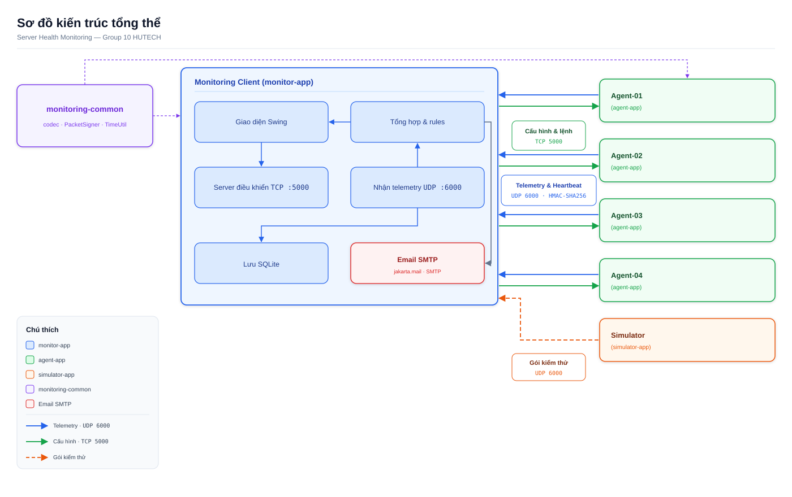
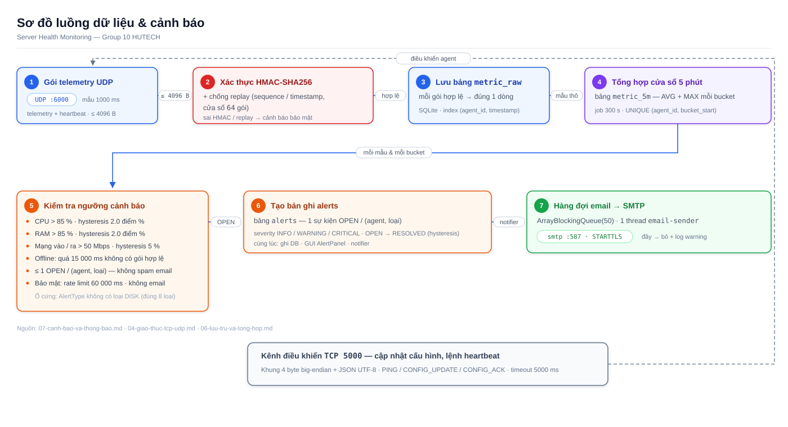
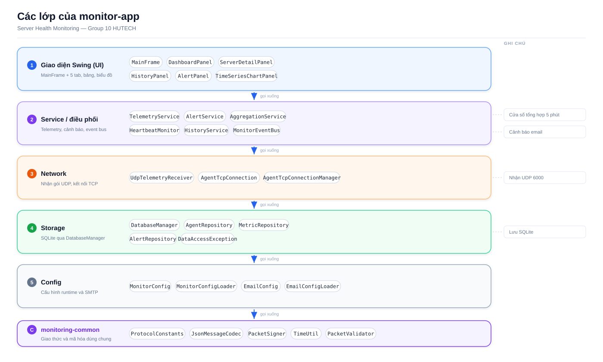

# Sơ đồ tĩnh (SVG) — chèn vào báo cáo Word

3 sơ đồ vector tự chứa (không ảnh ngoài, không CSS ngoài), nền trắng, nhãn
tiếng Việt, mở trực tiếp bằng trình duyệt. Chèn vào Word:
Chèn → Hình ảnh → Từ tệp → chọn file `.svg`.

## 1. Kiến trúc tổng thể

- Khung 1400×880. Trọng tâm: Monitoring Client (`monitor-app`) ở giữa —
  4 Agent (`agent-app`) và Simulator (`simulator-app`) ở cạnh phải.
- Luồng chính: telemetry & heartbeat **UDP 6000 + HMAC-SHA256**
  (agent/simulator → monitor); cấu hình & lệnh **TCP 5000**
  (monitor → agent); monitor → SQLite và Email SMTP.
- Dải `monitoring-common` (codec, `PacketSigner`, `TimeUtil`) dùng chung
  cho cả hai phía.

## 2. Luồng dữ liệu & cảnh báo

- Khung 1400×760. Chuỗi 7 chặng: gói telemetry UDP → xác thực HMAC
  + chống replay (sequence/timestamp, cửa sổ 64) → lưu `metric_raw` →
  tổng hợp cửa sổ 5 phút (`metric_5m`) → kiểm tra ngưỡng → ghi `alerts` →
  hàng đợi email → SMTP.
- Hộp ngưỡng liệt kê đúng giá trị trong tài liệu: CPU > 85%,
  RAM > 85% (hysteresis 2.0 điểm %), mạng vào/ra > 50 Mbps
  (hysteresis 5%), kèm làn điều khiển TCP 5000.

## 3. Các lớp của monitor-app

- Khung 1400×840. 5 tầng từ trên xuống: Swing UI → Service →
  Network → Storage → Config, mũi tên "gọi xuống"; dải dưới cùng là
  `monitoring-common` (protocol, codec, `PacketSigner`, `TimeUtil`).
- Tên class lấy đúng theo `docs/04-tai-lieu-class/`; cột ghi chú phải
  nhắc: nhận UDP 6000, cửa sổ tổng hợp 5 phút, lưu SQLite, cảnh báo email.
